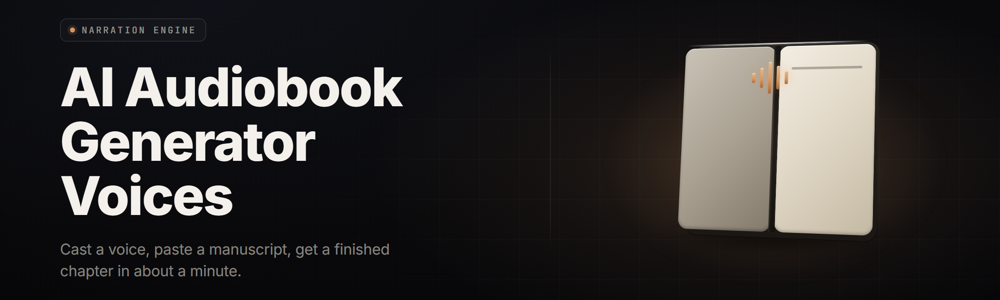

  
  
  

  

  
  

---

**Turn any manuscript into a full multi-voice audiobook — on your own machine, offline, no per-hour cloud bill, no narrator contract.**

I shipped the first build of Forge in a rented basement office with a mic taped to a broom handle and eleven dollars of leftover GPU credits. Six years later I still run every release on `main` before it hits the landing page. This repo is what those years produced: a Windows `.exe` that eats EPub, DOCX, Markdown, and plain TXT and spits out chaptered M4B files with distinct character voices, room tone, breath, and chapter cue tones.

If you've ever priced out a full-length audiobook, you already know why this exists. If you haven't — sit down, because the math hurts.

---

## 🗂️ Table of Contents

- [Overview](#overview)
- [The Problem](#the-problem)
- [The Solution](#the-solution)
- [Comparison](#comparison)
- [Installation](#installation)
- [Usage guidelines](#usage-guidelines)
- [Voice Engine Modules](#voice-engine-modules)
- [Manuscript & Script Modules](#manuscript--script-modules)
- [Audio Post Modules](#audio-post-modules)
- [Export & Packaging Modules](#export--packaging-modules)
- [System Requirements](#system-requirements)
- [What is Multi-Voice Rendering](#what-is-multi-voice-rendering)
- [Known Issues](#known-issues)
- [FAQ](#faq)

---

## 🔭 Overview

| Category | Details |
| --- | --- |
| Product | AI Audiobook Voice Forge — offline multi-voice audiobook renderer |
| Distribution | Windows `.exe`, portable, no installer wizard |
| Input formats | EPUB 2/3, DOCX, Markdown, ODT, TXT, plain chaptered HTML |
| Output formats | M4B (chapters + cues), MP3 chapter bundle, WAV stems, SRT/VTT |
| Voice set | 84 bundled neural voices — 52 English, 32 international |
| Direction | Character-tagged dialogue, narrator/all-caps/italic heuristics |
| Hardware | Local GPU acceleration (CUDA 12 / Vulkan / CPU fallback) |
| Cost model | One-time. No runtime seat fee, no cloud render queue |
| State | v2.7.3 nightly, tested on `main`, Windows first |

Voice Forge runs entirely on your hardware. It reads your manuscript, tags speakers, applies a per-character voice profile, renders each line, and assembles a mastered chapter track with room tone baked so pauses never go dead-silent. The output is a real audiobook distribution file, not a novelty TTS dump.

There's a long tail of features — pronoun-aware dialogue tagging, per-character pitch drift, breathing insertion, pronunciation dictionaries for names and jargon, and a cue system for chapter intros/outros. Scroll for the module catalog; it's grouped by the stage of the pipeline each one lives in.

---

## 🎧 Download

  

---

## 😩 The Problem

- **Studio narrators cost $250–$600 per finished hour.** A 12-hour novel is a five-figure project before you've touched a single edit.
- **Cloud TTS bills scale with listener hours, forever.** Every re-render, every typos fix, every character-voice change re-queues and re-charges.
- **Single-voice TTS flattens the book.** A wall of identical narrator drone is the fastest way to make a thriller sound like a textbook.
- **Pronoun attribution is where auto-taggers die.** He said / she said / the captain said / two lines of action without any tag at all — generic tools assign the wrong voice and never recover.
- **No pause control means dead spots.** TTS tools drop abrupt silence between paragraphs. Real narration has breath, room, subtle head noise — and tools ignore it.
- **Chapter marks are an afterthought.** Baked-in metadata lost on export; the file opens at chapter one forever with no cue positions.
- **Fansubbing-style re-recording is impossible.** You can't say "keep every line but re-render chapter 7 with more grit on the villain" in a cloud pipeline without paying twice.

---

## 🛠️ The Solution

| Problem | Solution |
| --- | --- |
| Per-hour narrator cost | 84 local neural voices, one-time build, unlimited re-renders |
| Cloud runtime billing | Fully offline render — your GPU is the render farm |
| Single-voice drone | Character-tagged multi-voice layout with profile inheritance |
| Pronoun attribution failures | Dialogue attribution engine with pronoun coreference + manual override |
| Dead silence between lines | Room-tone bed + breath-insert layer under pauses |
| Missing chapter metadata | Chapter cue generator that writes into M4B/AAC + sidecar cuesheet |
| Can't re-render partially | Cache-per-line engine — re-render only what you edit |

---

## 📊 Comparison

| Aspect | Cloud TTS SaaS | Single-voice desktop tools | This Tool |
| --- | --- | --- | --- |
| Cost per audiobook | $40–$900 depending on length | $0 after license | $0 after build ($0 runtime) |
| Voice count | 40–200 but subscription-gated | 1–3 droney voices | 84 local neural voices |
| Multi-voice switching | Manual script edits per line | Not possible | Auto-tag + manual overrides |
| Offline render | No | Usually yes | Yes (fully offline) |
| Pronunciation dictionary | Limited / not persistent | Manual sed hacks | Per-book dictionary, persists |
| Partial re-render | Re-bills whole chapter | Whole file | Per-line cache, re-render selectively |
| Output format | MP3 / M4B limited | MP3/WAV only | M4B + MP3 + WAV stems + SRT/VTT |
| Distribution-packaging | None | None | Chapter metadata, cover embed, ID3 map |

---

## 💿 Installation

1. **Download the latest release.** Hit the download link on the project landing page — one portable `.exe`, no bundled installer wizard, no repo needed.
2. **Extract anywhere you have write access.** Unzip into a folder you own — avoid `Program Files` on first run unless you'll be running as admin. Windows Defender will likely flag the file once as unsigned; add an exclusion for the folder if SmartScreen blocks the first run.
3. **Run the `.exe` and let it initialize.** First launch allocates a working directory under `%LOCALAPPDATA%\VoiceForge` and unpacks the bundled voice set on the first render. Pack unpack is a one-time ~2.1 GB step; it slows first-render only.

If you have a CUDA 12–capable GPU, Forge auto-detects it on launch. If it doesn't, drop a `voiceforge.toml` with `backend = "vulkan"` or `backend = "cpu"` next to the `.exe` and restart. CPU render works but expects roughly 8–11× realtime on a modern desktop CPU.

---

## ⚖️ Usage guidelines

| Allowed | Not allowed |
| --- | --- |
| Your own manuscripts and manuscripts you hold rights to | Rendering copyrighted books you don't own rights to distribute |
| Public-domain works (Gutenberg, etc.) for personal library | Uploading completed commercial audiobooks to piracy mirrors |
| Fan translations of *your own* works with attribution | Using bundled voices to impersonate real public figures |
| Personal journals, drafts, educational material | Deepfake narration for fraud, scams, or harassment |
| Client work where you hold narration rights | Removing or misrepresenting the license notice |

Be a decent publisher. Voice Forge doesn't DRM-lock your output; we just ask that you honor the copyright status of what you feed it.

---

## 🎙️ Voice Engine Modules

**Voice Profiles** — what the renderer calls a "voice."

| Feature | Effect |
| --- | --- |
| 84-voice library | Cache-resident, memory-maps on launch for fast switch |
| Voice cloning import (16-bit WAV, ≥30s clean) | Adds a private voice profile to the per-user library |
| Pitch drift model | Adds sub-1% pitch variance per paragraph — no more robotic monotone |
| Pace shaping | Per-voice and per-render length_scale control, 0.7–1.6× |
| Emotion sliders (7 axes) | Neutral / warm / tense / angry / sad / excited / clinical per character |
| Breath profile | Distinct breath timbre per voice, injected under pauses |
| Multilingual voices | 32 non-English voices, accents gated to correct phoneme maps |

---

## 📚 Manuscript & Script Modules

**Manuscript Handling** — getting from a document to a script.

| Feature | Effect |
| --- | --- |
| Autotagger dialogue recognizer | Quotes/scare-quotes/em-dashes attributed to nearest plausible speaker |
| Pronoun coreference | "He said / she said / the captain said" tracks who's who across paragraphs |
| Manual tag override editor | Keyword + dot-scope overrides for hard passages |
| Chapter splitter | Detects "Chapter N", numbered headings, roman numerals, EPUB spine |
| Front/back matter classifier | Separates title, copyright, dedication, credits, appendix |
| LaTeX + Markdown ingestion | Renders emphasis, footnotes, blockquotes into cue info |
| Name pronunciation dictionary | Per-book IPA-ish orthographic rules + pronunciation import (.lex) |
| Italics-to-emphasis pass | Reads italics as either verbatim emphasis or an aside — configurable |

---

## 🎚️ Audio Post Modules

**Mastering Chain** — what happens after the last line renders.

| Feature | Effect |
| --- | --- |
| Room-tone bed | Fills gaps between lines with matched noise floor, no dead air |
| De-esser | Softens sibilance hotspots on harsh voices |
| Loudness normalizer | Targets ACX/Spotify/TTS loudness presets, one click |
| Cross-fade looper | Chapter boundaries fade exactly the requested duration |
| Chapter cue tone | Optional chime/tick inserted at chapter heads, per-book on/off |
| Export dynamics preset | Narrows to a loudness curve for voice-first playback |
| Breath trim pass | Removes whisper-in breaths that GAN occasionally over-generates |

---

## 📦 Export & Packaging Modules

**Distribution Delivery** — getting the file out.

| Feature | Effect |
| --- | --- |
| M4B mux | Chaptered AAC file, ready for Apple Books/Audible-adjacent pipelines |
| MP3 chapter bundle | Folder-of-MP3 with embedded `CHAP` frame index |
| WAV stems export | Per-voice stems for downstream DAW work |
| SRT/VTT cursors | Sidecar subtitle track with per-sentence timings |
| Cover embed + ID3 map | Cover art and metadata written into the file, not just adjacent |
| Cuesheet sidecar | `chapter.cue` for hardware players that don't read M4B |
| Batch exporter | Renders a project list in one pass with the same profile |

---

## 🖥️ System Requirements

| Component | Minimum | Recommended |
| --- | --- | --- |
| OS | Windows 10 22H2 x64 | Windows 11 24H2 x64 |
| CPU | 4-core / 8-thread AVX2 | 8-core / 16-thread AVX-512 |
| GPU | None required (CPU mode) | NVIDIA RTX 3060 12 GB / any 8 GB+ modern dGPU |
| Backend | CPU | CUDA 12.x, Vulkan 1.3 fallback |
| RAM | 8 GB | 32 GB |
| VRAM | — | 8 GB+ |
| Storage | 6 GB free (voice pack + cache) | 40+ GB NVMe (project cache + stems + output) |
| Sound card | Any (no live playback required) | — |
| Admin rights | No (portable mode) | Only for Defender exclusion |

---

## 📖 What is Multi-Voice Rendering

| Term | Explanation |
| --- | --- |
| **Neural voice** | A trained acoustic model + vocoder pair producing one speaker identity |
| **Voice profile** | Named bundle of neural voice + pitch drift + pace + breath + emotion bias |
| **Autotagger** | The pass that walks the manuscript and assigns a speaker to every spoken line |
| **Coreference** | The algorithm that ties "he/she/they/the captain" to the earlier name mentioned |
| **Room tone** | A modeled noise floor so silences between lines sound like a room, not a void |
| **Cuesheet** | A `.cue` file indexing chapter boundaries for players that ignore embedded marks |
| **Stems** | Per-voice isolated render output usable in a DAW |

Key benefits of the multi-voice approach:

- Voice identity doesn't collapse into a single narrator pipeline.
- Pronoun-tracking keeps dialogues attributing correctly even when tags go silent.
- Partial re-renders reuse cached lines, saving GPU hours and keeping the same take across edits.
- Chapter metadata survives every export format — no re-muxing at the end.
- Emotional sliders sit at the profile level, so a book's characters stay consistent across chapters.

---

## 🐞 Known Issues

| Issue | Solution |
| --- | --- |
| First render slow (10–20× longer than steady rate) | Wait for voice pack to map entirely; subsequent renders hit normal speed |
| SmartScreen blocks first launch as unsigned binary | Right-click → Properties → Unblock; add folder to Defender exclusions |
| CUDA version mismatch crashes on launch | Run with `backend = "vulkan"` or `backend = "cpu"` in `voiceforge.toml` |
| Dialogue attribution flips in back-and-forth banter | Manually pin the speaker via the override editor or named-character block tags |
| M4B chapter count mismatch in rare players | Regenerate the cuesheet sidecar — some players ignore embedded `CHAP` |
| End-silence tail cut short on MP3 exports | Toggle "always append 1.2s tail" in Export → Advanced |

---

## ❓ FAQ

| Question | Answer |
| --- | --- |
| Do I need a GPU? | No. CPU mode works but expect 8–11× slower-than-realtime render. A modern CUDA/Vulkan GPU brings that to roughly 1.5–3× realtime. |
| Is rendering truly offline? | Yes. Once the voice pack is unpacked, no network calls happen during render. |
| Can it handle non-English books? | Yes — 32 non-English voices and accent-aware phoneme maps. Mixed-language books render voice-per-language correctly. |
| What's the largest manuscript it handles? | Tested on a 38-hour manuscript with 6 voices. Beyond ~40 hours in one file, split into projects for cache sanity. |
| How does it pick voices for characters? | Autotagger assigns voice by gender/age heuristic, then you assign named voices in the Profile Editor. Overrides win. |
| Can I clone a voice I have rights to? | Yes, via the WAV import (≥30s clean speech). Don't clone voices you don't have rights to. |
| Does it write Audible-ready M4B? | It writes chaptered M4B with cover + metadata + cues. Format-pipeline checks are your responsibility. |
| Will it re-render a whole chapter if I fix one line? | No. Per-line cache means only changed lines are re-rendered, and unchanged lines reuse the old take. |
| Is there a Linux/mac build? | Not in the current release. Windows first; the pipeline is cross-platform in source but packaging isn't official yet. |
| Does it DRM the output? | No. Output files are plain M4B/MP3/WAV. Honor the copyright of what you feed it. |

---

## 👋 Download

  

Every inch of this thing was bashed out between stubborn bugs and stubborn ideas, and it still renders clean on `main`. If your first audiobook comes out of it sounding like a real narrator sat in the room with your manuscript, the build did its job. Give the book a voice — then give it eleven more.
